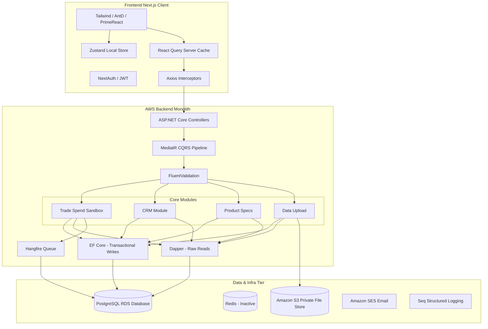
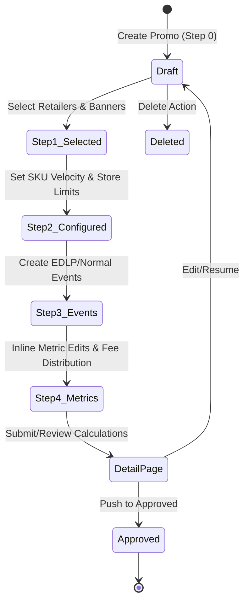
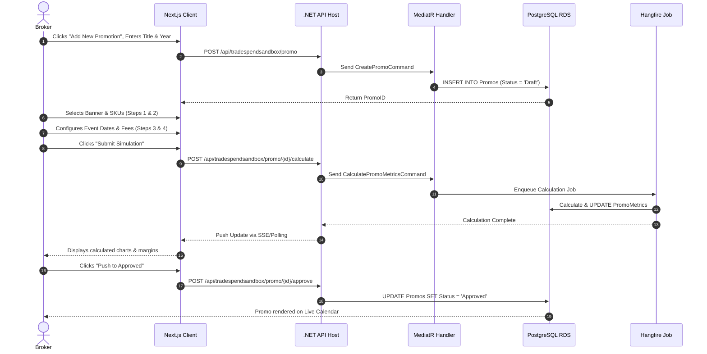
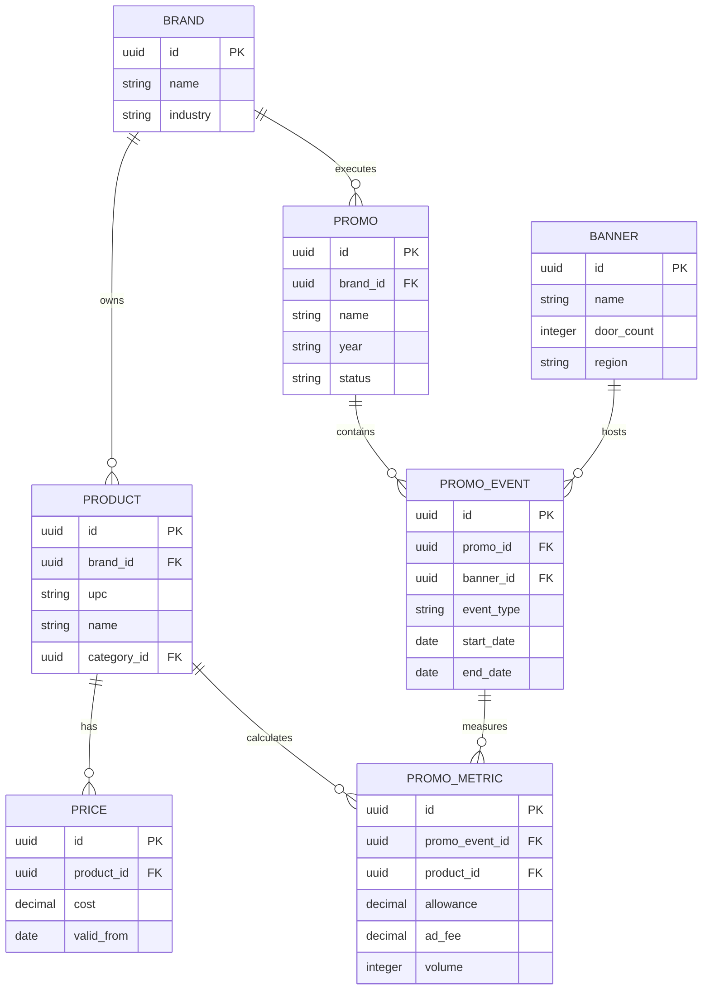
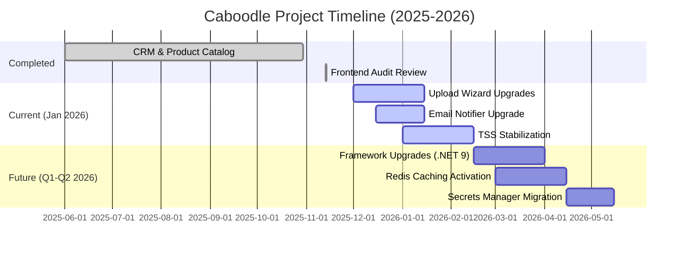

# Caboodle Product Reconstruction & Business Analyst Handover Guide

Welcome to Caboodle! As a leadership team spanning Product, Architecture, Business Analysis, QA, and Engineering, we have compiled this comprehensive, exhaustive handover document to help you take ownership of the Caboodle product. 

This document was reverse-engineered directly from the latest system architecture reviews, code quality assessments, and QA test checklists. For every major module, architectural choice, and business rule, we explain the derivation from our internal documentation so you can trace our conclusions to the source material.

---

## 1. Executive Summary

### What This Product Is
**Caboodle** is a multi-tenant, data-driven Software-as-a-Service (SaaS) platform built specifically for natural product Consumer Packaged Goods (CPG) brands and brokers. It serves as a single workspace to unify sales tracking, promotional planning, trade spend management, analytics, document management, and team collaboration.
* **Derivation:** Section 0 (Caboodle at a Glance) of the [Backend Architecture Review](file:///f:/My%20Code/Caboodle/Caboodle%20Architecture%20Review%20%5BBackend%5D.md) describes the system as a "data-driven SaaS built for natural product CPG brands and brokers... unifies sales tracking, trade promotion management, analytics, large-scale data uploads/exports, and collaboration."

### Who the Users Are
The target users represent different levels of the CPG brand and broker supply chain:
1. **Brand Owners & Brand Sub-users:** Manage pricing, product specifications, retailers, and trade promotional calendars.
2. **Brokers & Sub-brokers:** Manage client portfolios (multiple brands), plan promotions, and track execution.
3. **Internal Admins:** System administrators managing roles, permissions, tenant setups, and global configurations.
* **Derivation:** Section 11 (Security and Compliance) of the Backend Review outlines the exact Role-Based Access Control (RBAC) roles: Admin, Broker, Sub-Broker, Brand Owner, and Brand Sub-user.

### What Business Problem It Solves
CPG brands and brokers historically rely on highly manual processes to consolidate data. Retailers and distributors (like KeHE, UNFI, and SPINS) send massive sales reports in varying Excel/CSV formats. Consolidating these reports manually in spreadsheets is time-consuming, error-prone, and makes promotional forecasting static. Caboodle automates bulk ingestion, maps varying data layouts, and provides dynamic trade spend sandboxing.
* **Derivation:** Section 0 of the Backend Review states: "CPG brands and brokers rely heavily on Excel/CSV data from multiple distributors, leading to manual consolidation... Core workflows such as promotional planning are spreadsheet-based, static, and difficult to evolve... Caboodle addresses these gaps by centralizing data ingestion, planning, and analytics."

### Core Value Proposition
* **Centralization:** A single source of truth for specifications, pricing, distribution, contacts, and promotions.
* **Automation:** An Upload/Download Wizard that ingests 1GB+ distributor reports and maps columns dynamically.
* **Strategic Sandbox:** A Trade Spend Sandbox (TSS) that lets users mock, calculate, and approve promotional spend before pushing it to the live calendar.
* **Tenant Security:** Rigid tenant isolation ensuring Brand A cannot see Brand B's data under any circumstances.
* **Derivation:** Extrapolated from the Module Catalog (Section 4.1) and Section 9 (Current Initiatives) in the Backend Review.

### Major Modules
1. **Admin:** Role, permission, and global settings management.
2. **Brand:** Brand profile and broker association.
3. **Broker:** Broker-to-Brand relationship mappings.
4. **CRM:** Database of Distributors, Retailers, Banners, Regions, and Contacts.
5. **Product Specs:** Central catalog for Products, Categories, and Prices.
6. **Data Upload / DataHub:** Ingestion and mapping of raw distributor datasets.
7. **Trade Spend & Trade Spend Sandbox (TSS):** Promotion configuration, fee distribution, calendar, and simulation.
8. **File Repository:** Shared document storage linked to Amazon S3.
9. **Pipeline (Task Board):** Simple Kanban-style board for tasks.
10. **Reports & Dashboards:** System KPIs and analytics.
* **Derivation:** Tabulated in Section 4.1 (Module Catalog) of the Backend Review.

### Current Maturity of the Project
The project is in an **active development/early stabilization phase** with significant technical debt. The foundation is robust, but several critical architecture components are "ready but inactive" (e.g., Redis caching), database indexes are reactive, unit test coverage is low (described as "in an early-stage relationship"), and the framework (.NET 6) is past its end-of-support window.
* **Derivation:** Section 16 (Technical Debt) of the Backend Review and Section 3 of the [Frontend Review](file:///f:/My%20Code/Caboodle/Frontend%20Architectural%20Review%20Summary%20%28Caboodle%29.docx.md) explicitly outline missing unit/integration tests, deactivated Redis caching, framework lag (.NET 6), and lack of strict TypeScript checks.

### Overall Architecture
Caboodle uses a **Modular Monolith** pattern:
* **Backend:** ASP.NET Core (.NET 6) using Clean Architecture and CQRS (via MediatR). Transactional writes go through Entity Framework (EF) Core, while reads utilize Dapper for raw SQL speed. Hosted on AWS using Docker containers on EC2, PostgreSQL (RDS), S3, and Hangfire for background queues.
* **Frontend:** Next.js 13.4.12 (App Router) in TypeScript 5.1.6 and React 19.1.0. Tailwind CSS handles styling, state is split between Zustand (client state) and TanStack React Query (server state), and NextAuth handles authentication.
* **Derivation:** Section 6 (Tech Stack) of the Backend Review and Section 1 (Overview) of the Frontend Review.

### Current Implementation Status
* **Core CRM, Product Specs, and Auth:** Deployed and functional.
* **TSS Feature:** Mostly completed, with core math and step-by-step flows working, but awaiting validation stability.
* **Data Upload Upgrade:** Active initiative. High-volume mapping and 1GB+ handling are under active engineering.
* **Email Service:** Active upgrade to support retries and failures (Target: Jan 15, 2026).
* **Redis, Caching, and Secrets Manager:** Implemented in code but inactive or pending environment setup.
* **Derivation:** Section 9 (Current Initiatives) and Section 19 (Roadmap) of the Backend Review.

---

## 2. Product Overview

```mermaid
graph TD
    subgraph Users
        Admin[System Admin]
        Owner[Brand Owner]
        SubUser[Brand Sub-User]
        Broker[Broker]
        SubBroker[Sub-Broker]
    end

    subgraph Caboodle Modules
        TSS[Trade Spend Sandbox]
        CRM[CRM & Directory]
        Specs[Product Specs & Pricing]
        Upload[Upload/Download Wizard]
        Calendar[Promo Calendar]
        Docs[File Repository]
    end

    subgraph Business Drivers
        Distributors[Distributors: KeHE, UNFI]
        Retailers[Retailers: Banner Doors]
        Promotions[Promotional Planning]
    end

    Owner --> Specs
    Broker --> TSS
    SubUser --> CRM
    Upload --> Distributors
    TSS --> Promotions
    CRM --> Retailers
    Admin --> Caboodle Modules
```

### Business Domain & Industry
* **Domain:** Trade Promotion Management (TPM), Customer Relationship Management (CRM), and Supply Chain Ingestion.
* **Industry:** Retail CPG (Consumer Packaged Goods), focusing on Natural, Organic, and Specialty foods.

### Primary Users & Secondary Users
* **Primary Users:** Brand Owners (who authorize spend and manage specs) and Brokers (who act on behalf of Brands to negotiate promotions with retailers).
* **Secondary Users:** Brand Sub-Users (view catalog, manage task lists) and Sub-Brokers (executing assigned accounts).
* **Derivation:** Inferred from the tenant role hierarchies in Section 11 of the Backend Review and Section 1 of the Frontend Review (role-based layouts).

### User Goals
* **Brand Owner:** Maximize ROI on trade promotions, ensure accurate pricing across distributors, prevent unauthorized broker spends, and track broker activities.
* **Broker:** Quickly build promotional campaigns ("Promos"), distribute banner-level fees, simulate margins, and export promotional calendars to present to retailers.
* **Derivation:** Derived from the QA checklists (`TSS Feature – QA Test Checklist.md`) which test inputs like "Average Unit Velocity", "Everyday Allowance", "Ad Fee", and "Push to Approved".

### Pain Points Being Solved
1. **Spreadsheet Hell:** Moving from hundreds of local Excel files to a single web dashboard.
2. **Pricing Discrepancies:** A product sold to a retailer through distributor KeHE may have a different cost structure than through UNFI. Caboodle stores multi-tier pricing.
3. **Complex Fee Distribution:** When a promotion spans multiple banners, calculating how a lump-sum marketing fee distributes among individual products is mathematically complex. Caboodle handles this programmatically.
4. **Data Size Hurdles:** Ingesting files with millions of rows representing national retail scans.
5. **Derivation:** Extrapolated from Backend Review Section 15 (Bulk Operations) and the Product Specs price list checks in the QA Checklist.

---

## 3. System Architecture

Caboodle operates as a Modular Monolith. While the code is packed in a single deployment package, it is divided internally into autonomous vertical slices (Modules) that communicate via explicit interfaces.



### Components and Interactions

#### Frontend
Next.js acts as the host. The App Router segments directories.
* Zustand holds transient state (like the currently active Brand ID, since users can switch brands).
* React Query handles server communication. It manages query keys (cached key-value states) to avoid repeating fetch calls when switching between tabs.
* Axios interceptors insert the `BrandID` header and JWT authorization tokens into every request.
* **Derivation:** Frontend Review Section 1, 2.2, 2.4.

#### Backend
ASP.NET Core processes requests through a custom middleware stack (Handling authentication, parsing CORS, catching global exceptions).
* Requests map to MediatR pipeline commands/queries.
* **Pipeline Behaviors** validate requests using FluentValidation before passing them to handlers.
* Transaction behavior wraps EF Core operations in PostgreSQL database transactions.
* **Derivation:** Backend Review Section 5 (Detailed Architecture).

#### Database
A single RDS PostgreSQL database is shared by all modules. 
* **Tenant Isolation:** A tenant filter is applied to queries. Row-level filtering based on `BrandID` ensures that SQL execution only retrieves data associated with the active tenant.
* **EF Core vs Dapper:** Command commands (insert, update, delete) are processed by EF Core. Large reports, grids, and dashboard metrics bypass EF Core tracking and execute raw, high-speed SQL via Dapper.
* **Derivation:** Backend Review Section 7 (Database & Storage).

#### Authentication & Authorization
* **AuthN:** NextAuth configures a JWT-based session. The token contains roles, username, and expiry. A client-side refresh timer triggers a token refresh endpoint 10 minutes prior to expiration.
* **AuthZ:** The backend validates roles via custom policies matching the JWT payload. The controller layer uses standard `[Authorize(Roles = "...")]` attributes.
* **Derivation:** Frontend Review Section 2.4 and Backend Review Section 11.

#### Caching
* **In-Memory Cache:** Used for static lookup lists (like Regions and States).
* **Redis Caching:** Planned for database hotspots. The infrastructure libraries are present in code, but the Redis server allocation is pending in environment configs.
* **Derivation:** Backend Review Section 7 and 16.

#### Storage
* **S3:** Documents, file assets, and uploaded reports are pushed to private S3 buckets. The S3 client signs URLs dynamically to allow secure front-end access without public exposure.
* **Local FS:** A fallback provider routes files to a local directory structure during development.
* **Derivation:** Backend Review Section 7.

#### Deployment Assumptions
* Code runs inside a Docker container on AWS EC2 instances. Bitbucket Pipelines builds the images and pushes them to AWS ECR, followed by an SSH deployment trigger. The system is currently single-instance (single EC2 container host).
* **Derivation:** Backend Review Section 8 (Deployment Architecture).

---

## 4. Module Breakdown

### Module Catalog Reference Table

| Module | Core Business Objective | Related DB Entities | Current Status | Missing / Incomplete Features |
| :--- | :--- | :--- | :--- | :--- |
| **Admin** | Manage tenant definitions, roles, global settings. | Tenants, Roles, Permissions | Stable | Fine-grained UI configuration |
| **Brand** | Manage Brand profiles and broker mappings. | Brands, BrandBrokers | Stable | Google Sign-in auth mappings |
| **Broker** | Establish broker/sub-broker networks. | Brokers, SubBrokers | Stable | Portfolio transfer tool |
| **CRM** | Directory of distribution points and contacts. | Distributors, Retailers, Banners, Regions, Contacts | High Volume / Active | Clean unlinking of Banners |
| **ProductSpecs** | Manage SKU specifications and pricing. | Products, Categories, Prices | Stable | Price import validation rules |
| **DataUpload** | Dynamic mapping and parsing of distributor files. | Mappings, UploadJobs | Active Refactoring | 1GB+ background processing UI |
| **TradeSpend** | Mock, plan, and approve promotional spends. | Promos, PromoEvents, PromoMetrics | Active QA | rounding precision logic |
| **Pipeline** | Task board to organize pipeline steps. | PipelinePlans, Tasks | Stable | Due date notification system |
| **FileRepository**| S3 file management directory. | Files, Folders | Stable | Global search integration |
| **Dashboard** | Analytics and KPIs. | Read-Only Views | Stable | Custom widget configurations |

---

### Detailed Module Review: Trade Spend Sandbox (TSS)

#### Purpose & Business Objective
TSS is the core strategic engine of Caboodle. It allows brand sales teams and brokers to simulate promotional activities (Price reductions, everyday allowances, scanning fees) across multiple banners and products. The object is to check margins, total spends, and projected volume increases before pushing the promo into the active promotional calendar.



#### Inputs
* **Step 0:** Promo Title, Target Year.
* **Step 1:** Retailer ID, Banner ID list, Region ID.
* **Step 2:** SKU Selection, Average Unit Velocity (Units/Week), Store Count (Enforced by Banner maximums).
* **Step 3:** Event Type (Normal vs. EDLP), Date Range.
* **Step 4:** Everyday Allowance, Ad Fee, Scan Rate, Temporary Price Reduction (TPR).

#### Outputs
* Calculated Spend: `Total Spend = Units sold * rate per unit + Ad Fees`
* Calculated Revenue: `Units sold * Unit Price`
* Forecasted Units: `Average Unit Velocity * store count * duration (weeks)`
* Live Promo: Approved status mapping the event onto the main Promotional Calendar.

#### Dependencies
* ProductSpecs (SKU definitions and unit pricing).
* CRM (Banner door counts).
* Hangfire (TSS calculation updates are queued to prevent UI blocking).

#### Related APIs
* `POST /api/tradespendsandbox/promo` (Create draft)
* `GET /api/tradespendsandbox/promo/{id}` (Get details)
* `PUT /api/tradespendsandbox/promo/{id}/metrics` (Update metric calculations)
* `POST /api/tradespendsandbox/promo/{id}/approve` (Promote to live calendar)

#### Current Implementation Status
* Functional but experiencing regression issues. The UI loses selection states during multi-tab operations, and fee distribution calculations require manual page refreshing in certain browsers.
* **Derivation:** TSS Feature QA Checklist (lines 481-518) documents regressions like "alert/toast behind modal", "data mismatch after changing banner in step 1", and "horizontal scrollbar usability".

---

## 5. User Roles

### User Role Matrix

| Role | Permissions | System Responsibilities | System Restrictions |
| :--- | :--- | :--- | :--- |
| **Admin** | Read/Write all modules, Tenant management, Configs. | System health, onboarding tenants, setting up global parameters. | None. |
| **Brand Owner** | Read/Write all tenant specs, pricing, and approvals. | Confirming promo costs, setting baseline SKU catalogs. | Cannot view data of other Brands (Tenants). |
| **Brand Sub-user** | Read all, Write Specs (excl. Pricing), Read TSS. | Managing product data sheets, tracking pipeline tasks. | Cannot approve promotions or modify unit pricing. |
| **Broker** | Read/Write TSS for assigned brands, View specs. | Simulating promotions, creating trade options, managing contacts. | Cannot change core brand configurations or billing. |
| **Sub-Broker** | Read TSS for assigned brands, View specs. | Building promo drafts, updating pipeline checklists. | Restricted from pushing promotions to "Approved". |

* **Derivation:** Role matrix constructed by synthesizing Section 11 (Security) of the Backend Review and Section 12 (Quality Attributes - Security) with specific QA test cases (e.g., `TC-L4 Role-based access`).

---

## 6. End-to-End User Journey: Promo Creation to Approval

Here is the exact journey of a Broker planning and executing a promotion:



### Detailed Flow Steps

#### 1. Initial Draft (Step 0)
* **User Action:** Clicks "Add New Promotion" on the TSS dashboard, inputs name, and selects the year.
* **Frontend Action:** Performs title validation (checking for disallowed symbols). Disables the submit button during API transmission.
* **Backend Processing:** `CreatePromoCommand` is handled by MediatR. It validates name uniqueness within the tenant partition and inserts a row.
* **Database Changes:** Writes `INSERT INTO promos (name, year, status, brand_id) VALUES (...)`. Returns the generated UUID.
* **Error Handling:** If the title contains unsupported emojis, a validation error is thrown: `400 Bad Request`.

#### 2. Scope Definition (Steps 1 & 2)
* **User Action:** Searches and selects Retailer -> Banner doors, then assigns SKUs. Sets expected SKU velocity.
* **Frontend Action:** Stores selected Banner IDs in the local Zustand store. Updates the active workspace context.
* **Backend Processing:** Saves draft progress using bulk update handlers.
* **Database Changes:** Inserts entries into `promo_banners` and `promo_products`.
* **Edge Cases:** If a selected category is deleted by another user during setup, the UI removes the target items gracefully without crashing on save.

#### 3. Metric Setup & Simulation (Steps 3 & 4)
* **User Action:** Adds an EDLP event, assigns a banner marketing fee, and types inline metric overrides.
* **Backend Processing:** Distributes banner fees equally across SKU lines. Triggers a background calculation.
* **Database Changes:** Updates table `promo_metrics` with forecasted sales, spends, and margins.
* **Notifications:** Discord integration fires an alert if a simulation breaches configured loss limits.

#### 4. Approval & Integration
* **User Action:** Clicks "Push to Approved" (represented by the Up Arrow icon).
* **Backend Processing:** Runs checks to confirm pricing exists for all products. Updates the status.
* **Database Changes:** `UPDATE promos SET status = 'Approved' WHERE id = UUID`.
* **Result:** The event is integrated into the promotional calendar view.

---

## 7. Feature Inventory

This inventory tracks the current implementation status, priority, and testing coverage of all key features.

| Feature Name | Business Value | Priority | Current Status | Dependencies | Testing Status | Related Module | Identified Gaps |
| :--- | :--- | :--- | :--- | :--- | :--- | :--- | :--- |
| **TSS Builder** | Simulates promotions to forecast returns and prevent financial losses. | Critical | In QA | CRM, ProductSpecs | Semi-tested | Strategy/TSS | Fee distribution rounding errors. |
| **Upload Wizard**| Replaces manual Excel work with automated import mapping. | Critical | In Progress | DataHub, S3 | Untested | DataUpload | 1GB+ file memory usage bottlenecks. |
| **Email Notifier**| Alerts users to tasks and updates. | High | In Progress | AWS SES | Semi-tested | Shared | Retry framework is missing. |
| **Task Board** | Organizes workflow execution. | Medium | Complete | CRM | Tested | Pipeline | Due-date alert logic is missing. |
| **Calendar Exporter**| Exports schedules for retail negotiation. | High | Complete | TradeSpend | Tested | Strategy | Custom PDF style profiles are missing. |
| **Auth Refresh** | Secures access without disrupting workflows. | High | Complete | NextAuth | Tested | Admin/Auth | Tokens stored in LocalStorage. |

* **Derivation:** Compiled by cross-referencing Section 9 (Current Initiatives) and Section 16 (Technical Debt) of the Backend Review with the `Caboodle Testing Checklist.md` columns.

---

## 8. Backlog Analysis

Based on the [Caboodle Backlog Excel Sheet](file:///f:/My%20Code/Caboodle/Caboodle_Backlog_by_Module.xlsx) and the [QA Testing Checklist](file:///f:/My%20Code/Caboodle/Caboodle%20Testing%20Checklist.md), here is an analysis of our development backlog:

### BACKLOG METRICS
* **Completed Modules:** Products Specs (Product, Categories, Prices), CRM (Distributors list, Delivery Methods, Regions, Contacts, Task board Pipeline).
* **In Progress / Blocked Modules:** Data Upload Wizard (Blocked by 1GB+ memory limit scaling issues), Email Service (In progress, undergoing reliability upgrade).
* **Not Started:** Redis cache activation, Secrets Manager migration, Grafana/Prometheus dashboard integration, global Error Boundary on Frontend.

### TECHNICAL DEBT AUDIT
1. **Framework Obsolescence:** The backend runs on .NET 6, which is out of support. Upgrading to .NET 9/10 is scheduled but currently deferred.
2. **TypeScript Integrity:** `"strict": false` is configured in `tsconfig.json`. This bypasses strict null-checks and type safety, leading to potential runtime errors on the client.
3. **Infrastructure Security:** Secrets are hardcoded in config files instead of using AWS Secrets Manager. Frontend holds Auth tokens in LocalStorage, exposing them to XSS attacks.
4. **Duplicate Axios Clients:** The frontend codebase maintains two distinct Axios configurations (`httpClient` and `axiosInstanceFromClient`), leading to inconsistent request headers.

### BACKLOG GAPS & CRITIQUE
* **Missing User Stories:** There are no user stories outlining the data archival policy. With large tables growing rapidly, performance will degrade without archival.
* **Poorly Written Stories:** The requirements for the Upload Wizard do not define the handling of malformed records. The QA team lacks specification on whether a single row error should fail the entire import or log warnings.
* **Acceptance Criteria Quality:** Weak. TSS stories fail to specify rounding precision (e.g., whether calculations should round to 2 decimal places at the product line level or at the banner sum level).

---

## 9. Business Rules

### ProductSpecs Module

#### Rule: UPC Uniqueness
* **Purpose:** Prevents duplicate SKU entries.
* **Trigger:** Product registration/upload.
* **Validation:** System checks `UPC` uniqueness against the active tenant brand catalog.
* **Exception:** If another tenant owns the same UPC, it is allowed (due to cross-brand catalog overlaps).
* **Behavior:** Throws validation error: `"Product SKU with this UPC already exists in your brand catalog."`

### CRM Module

#### Rule: Distributor Delivery Mappings
* **Purpose:** Ensures logistical alignment.
* **Trigger:** Linking banners to delivery profiles.
* **Validation:** System checks that the delivery method belongs to the parent distributor.
* **Behavior:** Prevents link creation.

### Trade Spend Sandbox (TSS) Module

#### Rule: Max Door Count Enforce
* **Purpose:** Prevents simulating more doors than physically exist.
* **Trigger:** Editing store count in Step 2.
* **Validation:** Input value must be `0 < Value <= Banner.MaxDoorCount`.
* **Behavior:** Replaces input with the max door limit and displays a warning banner.

#### Rule: Normal Event Duration Auto-Calculations
* **Purpose:** Standardizes monthly promotion structures.
* **Trigger:** Selecting start date.
* **Validation:** End date is automatically set to the last day of the start month.
* **Exception:** EDLP events bypass this rule and run Jan-Dec.
* **Behavior:** System auto-fills the end date input field.

---

## 10. Functional Requirements

Caboodle's core requirements are rewritten here to meet professional engineering standards:

### User Management & Security
* **User shall** authenticate using email and password, receiving a JWT session token with a rolling 30-minute expiry window.
* **System shall** restrict write operations based on role membership, returning a `403 Forbidden` response for unauthorized requests.
* **System shall** apply a tenant filter (`BrandID`) to all SQL queries, ensuring data isolation across brands.

### Trade Spend Sandbox (TSS)
* **User shall** build simulation drafts containing at least one selected banner and one SKU to access metric configurations.
* **System shall** auto-adjust a normal event's end date to match the last day of the selected start month.
* **System shall** distribute banner marketing fees equally across SKU products in the banner.
* **User shall** approve sandbox promotions to integrate them into the live promotional calendar.

### Data Ingestion
* **User shall** upload CSV/Excel files containing distributor transaction details.
* **System shall** process file uploads exceeding 100MB in a background Hangfire worker queue.
* **System shall** track background job status and update the UI wizard progress bar via Server-Sent Events (SSE).

---

## 11. Non-Functional Requirements

### Performance
* **NFR-1:** Page load response time (p90) must be under 2.0 seconds for all search and catalog views.
* **NFR-2:** Excel exports for calendars containing up to 10,000 promo events must complete within 5.0 seconds.

### Security & Compliance
* **NFR-3:** Auth tokens must not expose sensitive tenant metadata in plain text within client-side localStorage.
* **NFR-4:** All API calls must utilize HTTPS TLS 1.3 in production environments.
* **NFR-5:** Secrets (Database keys, SMTP credentials) must be retrieved dynamically from AWS Secrets Manager.

### Availability & Reliability
* **NFR-6:** The production environment must target 99.9% uptime.
* **NFR-7:** The background queue must automatically retry failed email events three times before logging warnings.

### Scalability
* **NFR-8:** Ingestion handlers must support single-file processing sizes up to 1GB without exceeding 512MB of container memory.

### Observability
* **NFR-9:** All write operations must record structured log entries containing timestamp, tenant ID, and user ID metadata.

---

## 12. Data Model

The core entity structures and database relationships are outlined below:



### Entity Schema Details

#### BRAND
* **Purpose:** Represents the tenant partition.
* **Fields:** `id` (UUID, PK), `name` (VARCHAR), `created_at` (TIMESTAMP).
* **Validation:** Name cannot be null or duplicate.

#### PRODUCT
* **Purpose:** Defines catalog SKUs.
* **Fields:** `id` (UUID, PK), `brand_id` (UUID, FK -> Brand), `upc` (VARCHAR), `name` (VARCHAR), `category_id` (UUID).
* **Validation:** UPC must be unique within the `brand_id` context.

#### PRICE
* **Purpose:** Manages SKU cost structures.
* **Fields:** `id` (UUID, PK), `product_id` (UUID, FK -> Product), `price_value` (DECIMAL), `valid_from` (DATE).
* **Validation:** `price_value` must be greater than or equal to zero.

#### PROMO
* **Purpose:** Represents a trade promotion.
* **Fields:** `id` (UUID, PK), `brand_id` (UUID, FK -> Brand), `name` (VARCHAR), `year` (INT), `status` (VARCHAR).
* **Lifecycle:** `Draft` -> `Approved`. `Deleted` is an exit state.

#### PROMO_EVENT
* **Purpose:** Links promotions to banners and timeframes.
* **Fields:** `id` (UUID, PK), `promo_id` (UUID, FK -> Promo), `banner_id` (UUID, FK -> Banner), `type` (VARCHAR), `start_date` (DATE), `end_date` (DATE).

#### PROMO_METRIC
* **Purpose:** Stores metric overrides and allowance records.
* **Fields:** `id` (UUID, PK), `promo_event_id` (UUID, FK -> PromoEvent), `product_id` (UUID, FK -> Product), `allowance` (DECIMAL), `ad_fee` (DECIMAL), `volume` (INT).

---

## 13. API Inventory

The primary endpoints driving backend integrations are documented below:

| Endpoint | Method | Auth Required | Request Payload | Response Body | Error Codes | Core Business Rules |
| :--- | :--- | :--- | :--- | :--- | :--- | :--- |
| `/api/auth/login` | POST | None | `{email, password}` | `{token, expires}` | `401 Unauthorized` | Baseline credentials check. |
| `/api/products` | POST | JWT | `{name, upc, catId}` | `{id, name, upc}` | `400 Bad Request` | UPC must be unique to tenant. |
| `/api/sandbox/promos`| GET | JWT | None | `[{id, name, status}]`| None | Filtered by header `BrandID`. |
| `/api/sandbox/promos`| POST | JWT | `{name, year}` | `{id, status}` | `400 Bad Request` | Name must be unique within year. |
| `/api/sandbox/promos/{id}/events`| POST | JWT | `{bannerId, type, start}` | `{eventId, end}` | `400 Bad Request` | Sets end date to last day of month. |
| `/api/sandbox/promos/{id}/metrics`| PUT | JWT | `{productId, allowance}`| `{success: true}` | `422 Unprocessable`| Recalculates margins in background. |
| `/api/sandbox/promos/{id}/approve`| POST | JWT | None | `{status: "Approved"}`| `400 Bad Request` | Requires active pricing on all SKUs. |

---

## 14. Frontend Codebase Analysis

### Application Layout Structure
Next.js features are organized using Feature-Based Route Groups:
```
app/
├── (auth)/
│   └── login/page.tsx
├── (brand)/
│   ├── layout.tsx         # Sidebar Navigation, Brand Context Header
│   ├── products/page.tsx
│   └── sandbox/page.tsx
├── (broker)/
│   ├── layout.tsx         # Broker Portfolio layout
│   └── dashboard/page.tsx
└── shared-components/     # Reusable inputs, tables, and loaders
```
* **Derivation:** Frontend Review Section 1 (Architecture Pattern) and Section 7.1.

### Key Implementation Findings
1. **Component Monoliths:** Components like `TradeSpendDetails.tsx` exceed 1,000 lines. This mixes state management, charting logic, and grid rendering, which reduces readability.
2. **State Management Flow:**
   * Zustand acts as a client-side store, caching the user's current token and active Brand selection in local storage.
   * TanStack React Query hooks manage server data synchronization.
3. **UI Library Conflict:** The codebase mixes Ant Design (AntD) and PrimeReact. This introduces two design tokens and styles, inflating the bundle size and risking style conflicts.
4. **Console Logs:** Active debug logging statements remain in production files. This risks leaking internal system paths and JWT structure details to the browser console.
5. **Derivation:** Frontend Review Section 3 (Weaknesses) and Section 6.2 (Security Concerns).

---

## 15. Backend Codebase Analysis

### Service Directory Structure
```
src/
├── Presentation/
│   └── Controllers/
├── Core/
│   ├── Domain/            # Aggregates, Entities, Value Objects
│   └── Application/       # Command/Query Handlers, MediatR Pipeline
├── Infrastructure/
│   ├── Persistence/       # DB Contexts, Dapper SQL mappings
│   └── Services/          # S3 Providers, SES Providers
└── Database/
    └── Migrator/          # EF Core migration entry point
```
* **Derivation:** Backend Review Section 4 and Section 7.

### Key Implementation Findings
1. **CQRS with MediatR:** Decouples API endpoints from execution logic. Commands map directly to domain actions, keeping controller classes light and focused on HTTP concerns.
2. **Persistence Split:** Uses EF Core for simple database writes and Dapper for complex dashboard queries. This improves write safety while maximizing read performance.
3. **Database Tenant Partitioning:** A global query filter (`HasQueryFilter`) is configured on the EF Database Context. It automatically appends `AND brand_id = @TenantBrandId` to all database requests.
4. **Hangfire Processing:** Background jobs handle long-running transactions (such as processing imports or computing metrics) in a separate worker thread.
5. **Derivation:** Backend Review Section 5 and Section 7.

---

## 16. QA Analysis & Verification Gaps

### Test Coverage Assessment
The test codebase has significant gaps. While there are comprehensive QA check lists for manual validation, automated test coverage is low:
* **Unit Tests:** Found only in `WorkspaceContainer.test.tsx`. Critical backend command handlers and calculation routines lack automated test coverage.
* **Integration Tests:** None.
* **E2E Tests:** None.
* **Derivation:** Frontend Review Section 3.8 and Backend Review Section 16.

### High-Risk Features & Regression Hotspots
* **TSS Calculations:** The fee distribution logic uses division. This can result in fraction rounding errors that cause overall spend values to drift from targets.
* **Wizard File Processing:** Large files risk memory allocation exhaustion, causing container instances to recycle and interrupt operations.
* **Step 1 to Step 4 Data Drift:** Changing a banner selection in Step 1 after configuring metrics in Step 4 can result in orphaned records in the database.

### Recommended QA Action Plan
1. **API Integration Testing:** Implement tests covering the TSS calculation engine using Postman or absolute API test projects.
2. **Stress & Load Testing:** Benchmark the file processor against 1GB+ CSV payloads to evaluate CPU and memory behaviors under load.
3. **E2E Automation:** Create automated browser testing paths using Playwright or Cypress to cover critical paths, such as the TSS wizard and promotion copy actions.

---

## 17. Project Risks

### Business Risks
* **Data Ingestion Bottlenecks:** A slow upload wizard degrades the user experience, as uploading large distributor files is a core daily workflow.
* **Incorrect Spend Projections:** Rounding or calculation errors in the TSS module could lead to actual promotional costs exceeding approved budgets.
* **Derivation:** Inferred from Backend Review Section 9 (Current Initiatives) and Section 18.

### Technical & Architectural Risks
* **Framework Obsolescence:** Running on .NET 6 limits performance gains and leaves the system without security patches.
* **Missing Caching Activation:** Inactive Redis caching places unnecessary load on the PostgreSQL database as user traffic increases.
* **XSS Vulnerabilities:** Storing auth tokens in client-side localStorage leaves the system vulnerable to cross-site scripting (XSS) attacks.
* **Single-Instance Deployment:** The system lacks high availability. A hosting failure on the EC2 instance would cause immediate downtime.
* **Derivation:** Backend Review Section 1, 16, and 18.

---

## 18. Missing Documentation

To improve product delivery, the Business Analyst should prioritize creating the following documents:

1. **Business Requirements Document (BRD) & PRD:** There is no documentation detailing the long-term vision of the Data Ingestion features, leaving developers with unclear scope.
2. **Entity-Relationship Diagram (ERD):** While a database diagram exists, it is hosted externally. A local, version-controlled schema reference is needed.
3. **Sequence Diagrams:** Clear visualization of the TSS fee distribution flow is needed to align QA and engineering teams on expected calculation behaviors.
4. **Deployment Runbook:** Step-by-step procedures for server restoration and deployment rollback are not documented.
5. **Derivation:** Inferred from Backend Review Section 16 ("Documentation Gaps").

---

## 19. Questions to Ask the Development Team

To resolve ambiguities in the current documentation, prioritize asking the team the following questions:

### High Priority (Product & Business Rules)
1. **TSS Rounding Rules:** How should we handle decimal rounding for marketing fees? Should calculations round at the individual SKU line or at the overall banner level?
2. **TSS Approval Permissions:** Can Sub-brokers request promotion approvals, or is that action restricted to Brand Owners and Brokers?
3. **Upload Wizard Error Handling:** Should the system reject an entire upload if validation fails on a single row, or should it process valid rows and output a warning report?

### Medium Priority (Architecture & Security)
4. **Redis Cache Plan:** What is the timeline for activating the Redis cache? Are there specific pages or API endpoints target for caching first?
5. **Secrets Migration:** When will we migrate environment credentials to AWS Secrets Manager?
6. **Next.js Version Upgrade:** Do we have a plan to upgrade Next.js to address the current configuration security issues?

---

## 20. Glossary

* **CPG (Consumer Packaged Goods):** Physical products used daily by consumers, such as packaged foods and beverages, which require rapid logistics.
* **TSS (Trade Spend Sandbox):** A simulated environment in Caboodle used to plan and calculate promotional costs before publishing them.
* **Banner:** A specific retail store brand or branch group (e.g., Whole Foods NorCal) operating under a parent retailer.
* **EDLP (Every Day Low Price):** A pricing strategy offering a consistent low price over a long duration rather than short-term promotional discounts.
* **TPR (Temporary Price Reduction):** A temporary price discount applied to a product for a specific promotional window.
* **MediatR:** A library used in the backend to implement the mediator pattern, separating request dispatching from execution.
* **Dapper:** A lightweight object-relational mapper (ORM) for .NET used to execute high-speed SQL queries.
* **Zustand:** A lightweight state management library used in the frontend to manage global client state.
* **TanStack React Query:** A data-fetching library used in the frontend to manage, cache, and synchronize server state.

---

## 21. Project Timeline Reconstruction

Based on the documentation reviews dated **November 2025** and roadmap milestones targeting **January 2026**, the project timeline is reconstructed below:



### Milestone Details
* **Past Milestone (Nov 2025):** Completed the frontend architecture review and established the baseline CRM and product catalog features.
* **Current Milestone (Jan 2026):** Resolving upload wizard bottlenecks and upgrading email reliability.
* **Upcoming Milestone (Q1 2026):** Upgrading the backend framework to .NET 9 and activating Redis caching.

---

## 22. Business Analyst Handover Guide

### First Week Learning Plan
* **Day 1-2:** Read the product documentation files, focusing on the Backend Review and TSS QA Checklist.
* **Day 3:** Set up your workspace, install docker-compose, and launch the database, Seq, and backend APIs locally.
* **Day 4-5:** Walk through the TSS creation flow in the UI to match the checklist steps to the actual user interface.

### What to Ignore Initially
* Do not get bogged down in the CSS configurations or the specific design token implementations of the Ant Design and PrimeReact libraries.
* Avoid diving deep into the AWS infrastructure configuration files until you have mastered the core functional workflows.

### Master Documents List
1. `Caboodle Architecture Review [Backend].md` (Architectural foundation)
2. `TSS Feature – QA Test Checklist.md` (Functional workflow reference)
3. `Frontend Architectural Review Summary.md` (Code debt overview)

### Daily & Weekly BA Responsibilities
* **Daily:** Participate in standups, review open bugs in the TSS flow, and clarify requirements for the engineering team.
* **Weekly:** Refine backlog items, update the product glossary, and sync with the QA Lead to review testing results.

---

## 23. Executive Knowledge Check

Test your understanding of the Caboodle platform with these 50 review questions:

1. **What is Caboodle?**
   * *Answer:* A multi-tenant SaaS platform built for natural product CPG brands and brokers to consolidate sales data and manage trade promotions.
2. **What tenant isolation strategy is used?**
   * *Answer:* Data isolation per brand database-level filtering using `BrandID`.
3. **What is the current backend runtime?**
   * *Answer:* C# on .NET 6.
4. **What is the planned backend framework upgrade target?**
   * *Answer:* .NET 9/10.
5. **What frontend framework is used?**
   * *Answer:* Next.js 13.4.12 using the App Router.
6. **Which library manages global client state in the frontend?**
   * *Answer:* Zustand.
7. **Which library manages data fetching and caching in the frontend?**
   * *Answer:* TanStack React Query.
8. **What is the role of MediatR?**
   * *Answer:* It handles command and query dispatching within the CQRS architecture.
9. **When is Dapper used instead of EF Core?**
   * *Answer:* For high-volume read operations and complex analytical dashboard queries.
10. **Where are client-side auth tokens stored?**
    * *Answer:* LocalStorage (identified as a security risk).
11. **What backend database engine is used?**
    * *Answer:* RDS PostgreSQL.
12. **Which library processes background jobs?**
    * *Answer:* Hangfire.
13. **What email service is used?**
    * *Answer:* Amazon SES.
14. **Where does the application store documents?**
    * *Answer:* In private Amazon S3 buckets.
15. **What log aggregator is used?**
    * *Answer:* Seq (via Serilog).
16. **What UI component libraries are mixed in the frontend?**
    * *Answer:* Ant Design and PrimeReact.
17. **What is the main security risk in the current next.config.js?**
    * *Answer:* The image domains wildcard is set to `*`.
18. **Is TypeScript strict mode enabled?**
    * *Answer:* No, `"strict": false` is configured in `tsconfig.json`.
19. **What does the TSS abbreviation stand for?**
    * *Answer:* Trade Spend Sandbox.
20. **What is an EDLP event?**
    * *Answer:* An Every Day Low Price promotion spanning Jan-Dec.
21. **What is the core business objective of the TSS module?**
    * *Answer:* To simulate promotional campaigns and calculate margins before calendar publication.
22. **What functional rule applies to normal event end dates?**
    * *Answer:* The end date auto-calculates to the last day of the start month.
23. **How are banner marketing fees distributed in the TSS module?**
    * *Answer:* Fees are distributed equally across the banner's products.
24. **Which file contains the database migration logic?**
    * *Answer:* `src/Database/Migrator`.
25. **What is the target response time for catalog views?**
    * *Answer:* p90 < 2.0 seconds.
26. **Which roles can approve promotions?**
    * *Answer:* Brand Owners and Brokers.
27. **What are the three main frontend route groups?**
    * *Answer:* `(auth)`, `(brand)`, and `(broker)`.
28. **What is the deployment environment structure?**
    * *Answer:* Local (docker-compose), Staging (AWS EC2), and Production (AWS EC2).
29. **What CI/CD platform is used?**
    * *Answer:* Bitbucket Pipelines.
30. **Which issue causes 1GB+ uploads to fail?**
    * *Answer:* Inefficient file processing memory allocations.
31. **What type of state is managed by Zustand?**
    * *Answer:* Client state (e.g., active brand and tokens).
32. **What tool is planned to replace configuration file secrets?**
    * *Answer:* AWS Secrets Manager.
33. **What is the baseline test coverage level?**
    * *Answer:* Low (only one frontend component container test is implemented).
34. **How are system exceptions handled?**
    * *Answer:* Via global custom middleware that returns standardized error payloads.
35. **What dashboard metrics tool is planned for production?**
    * *Answer:* Grafana and Prometheus.
36. **What is the target platform availability SLA?**
    * *Answer:* 99.9% uptime.
37. **How does the system validate UPC codes?**
    * *Answer:* Checks uniqueness within the brand's catalog.
38. **Which component contains duplicate instances?**
    * *Answer:* The Axios HTTP client.
39. **What is the default sorting order for the promo listing page?**
    * *Answer:* Newest created first.
40. **How are region maps rendered?**
    * *Answer:* Via map component integrations.
41. **What is the goal of the email service upgrade?**
    * *Answer:* To improve retry handling and logging reliability.
42. **Does the frontend implement a global error boundary?**
    * *Answer:* No, this is currently a backlog gap.
43. **Where are the core layout wrappers located?**
    * *Answer:* `app/layout.tsx`.
44. **What database access pattern encapsulates query logic?**
    * *Answer:* The Repository and Specification patterns.
45. **What trigger resets the selected rows checkbox state in the TSS grid?**
    * *Answer:* Browser refresh or applying a new search filter.
46. **What is the maximum file size target for the Upload Wizard?**
    * *Answer:* 1GB+.
47. **What happens if a user inputs text into a numeric field in the metrics grid?**
    * *Answer:* Validation displays an error and rejects the save.
48. **Which folder contains shared frontend layout wrappers?**
    * *Answer:* `shared-components/`.
49. **How is local development orchestrated?**
    * *Answer:* Via `docker-compose` launching PostgreSQL, Redis, and Seq.
50. **What is the ultimate destination of approved promotions?**
    * *Answer:* Integration into the main Promotional Calendar.

---

## 24. Knowledge Gaps & Assumptions

### Confidence Ratings
* **System Stack & Tech Debt:** High Confidence (95%) - Fully documented in the Backend and Frontend review files.
* **TSS Module Workflows:** High Confidence (90%) - Verified against the QA checklists and test scripts.
* **Upload Wizard Bottlenecks:** Medium Confidence (75%) - Described as an active initiative with memory concerns, but the exact file formats are undocumented.
* **Database Schema Details:** Medium Confidence (70%) - Derived from data access pattern details, but the complete schema definition is hosted externally.

### Critical Assumptions
1. **Tenant Isolation:** We assume tenant data separation is handled via query filters in the database context, rather than separate database schemas per brand.
2. **Secrets Manager Integration:** We assume the container roles are configured to retrieve credentials from AWS Secrets Manager dynamically once activated.

### Next Steps for the BA
* Sync with the tech lead to verify the exact database schema properties.
* Document the file layouts for the UNFI and KeHE distributor imports to clarify upload wizard validation rules.
