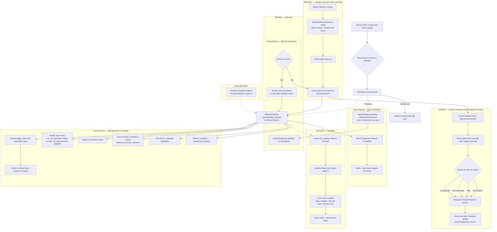

# Category Review — User Workflow (Mermaid Flow)

Mermaid flowchart capturing the client's Category Review user workflow requirements
(Notify Brands → Brand Report population → Brand-side response → Calendars → Report management).

## Key points captured

1. **Entry point:** Broker selects a review on the grid, chooses brands (owner + sub-users), sends the notification email from the Grid.
2. **Auto population:** Emailed brands appear in the Brand Report with **Brand Response = Notified**; date + user logged to notes.
3. **Manual option:** Broker can manually add a brand to the report even if no email was sent.
4. **Email link → brand side:** Brand chooses **Yes-Submit / TBD / Not Interested / Contact Me** from the link, which populates the Brand Response column. Broker can still override.
5. **Broker calendar:** All reviews shown; opted-in flag per cell; click opens detail (Type, Region, Review Start, Review End) with notes.
6. **Brand calendar:** Only reviews the brand added; **Notify Broker** checkbox pushes the review to the broker's report as **Yes-Submit** even before the broker's email.
7. **Declutter:** Global "hide Not Interested" toggle, remove brands, mark complete → cleared from tracker.
8. **Admin:** Controls the dropdown options for Brand Report columns.
